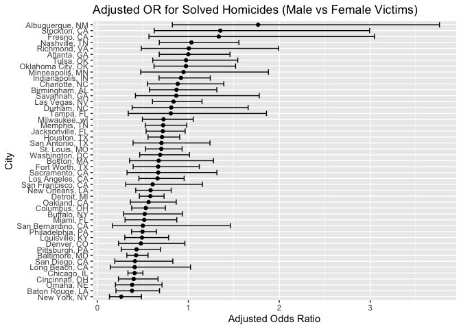
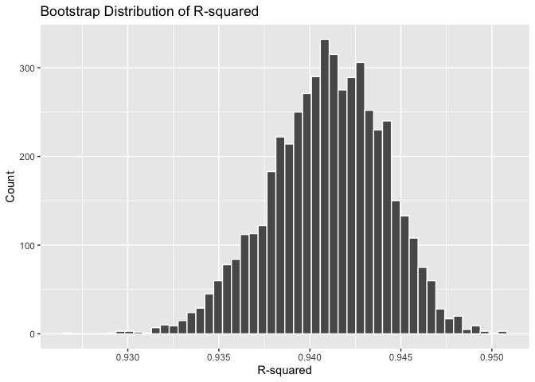
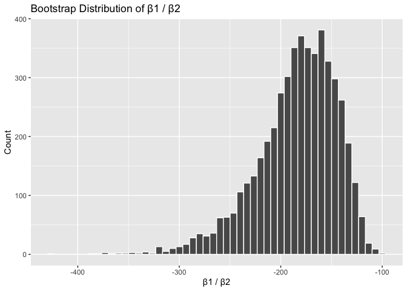
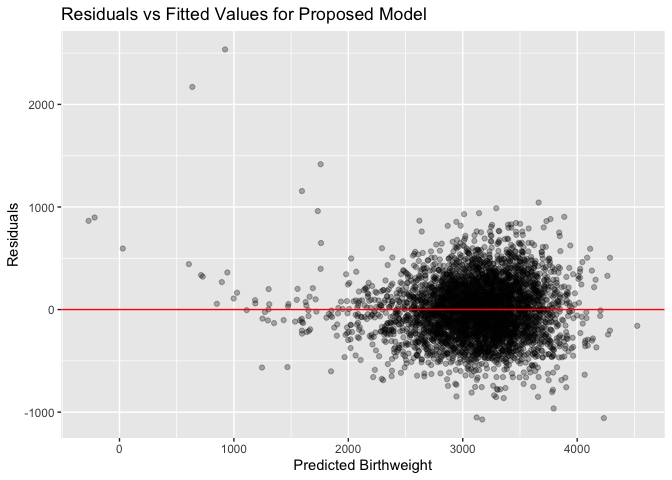
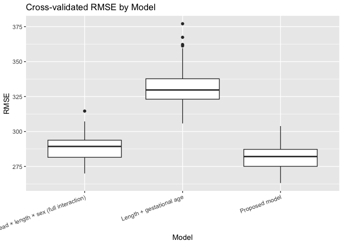

p8105_hw6_ht2717
================
Haoyi Tan (ht2717)

``` r
library(tidyverse)
```

    ## ── Attaching core tidyverse packages ──────────────────────── tidyverse 2.0.0 ──
    ## ✔ dplyr     1.1.4     ✔ readr     2.1.5
    ## ✔ forcats   1.0.0     ✔ stringr   1.5.1
    ## ✔ ggplot2   3.5.2     ✔ tibble    3.3.0
    ## ✔ lubridate 1.9.4     ✔ tidyr     1.3.1
    ## ✔ purrr     1.1.0     
    ## ── Conflicts ────────────────────────────────────────── tidyverse_conflicts() ──
    ## ✖ dplyr::filter() masks stats::filter()
    ## ✖ dplyr::lag()    masks stats::lag()
    ## ℹ Use the conflicted package (<http://conflicted.r-lib.org/>) to force all conflicts to become errors

``` r
library(modelr)
library(broom)
```

    ## 
    ## Attaching package: 'broom'
    ## 
    ## The following object is masked from 'package:modelr':
    ## 
    ##     bootstrap

\#Problem1

``` r
##Data cleaning
homicide_df = read_csv("data/homicide-data.csv")
```

    ## Rows: 52179 Columns: 12
    ## ── Column specification ────────────────────────────────────────────────────────
    ## Delimiter: ","
    ## chr (9): uid, victim_last, victim_first, victim_race, victim_age, victim_sex...
    ## dbl (3): reported_date, lat, lon
    ## 
    ## ℹ Use `spec()` to retrieve the full column specification for this data.
    ## ℹ Specify the column types or set `show_col_types = FALSE` to quiet this message.

``` r
homicide_df = homicide_df |> 
  mutate(
    city_state = str_c(city, state, sep = ", "),
    resolved = if_else(disposition == "Closed by arrest", 1, 0),
    victim_age = as.numeric(victim_age)
  ) |> 
  filter(
    !(city_state %in% c("Dallas, TX", "Phoenix, AZ", 
                        "Kansas City, MO", "Tulsa, AL")),
    victim_race %in% c("White", "Black")
  )
```

    ## Warning: There was 1 warning in `mutate()`.
    ## ℹ In argument: `victim_age = as.numeric(victim_age)`.
    ## Caused by warning:
    ## ! NAs introduced by coercion

``` r
##Baltimore logistic regression

baltimore = homicide_df |> 
  filter(city_state == "Baltimore, MD")

fit_baltimore = glm(
  resolved ~ victim_age + victim_sex + victim_race,
  data = baltimore,
  family = binomial()
)

baltimore_or = tidy(
  fit_baltimore, 
  conf.int = TRUE, 
  exponentiate = TRUE
) |> 
  filter(term == "victim_sexMale") |> 
  select(estimate, conf.low, conf.high)

baltimore_or
```

    ## # A tibble: 1 × 3
    ##   estimate conf.low conf.high
    ##      <dbl>    <dbl>     <dbl>
    ## 1    0.426    0.324     0.558

``` r
##This prints the Adjusted OR + CI for male vs female in Baltimore


##Fit glm for each city

nested_df = homicide_df |> 
  group_by(city_state) |> 
  nest()

model_results = nested_df |> 
  mutate(
    fit = map(data, ~ glm(
      resolved ~ victim_age + victim_sex + victim_race,
      data = .x,
      family = binomial()
    )),
    
    tidied = map(fit, ~ tidy(
      .x, conf.int = TRUE, exponentiate = TRUE
    ))
  ) |> 
  unnest(tidied) |> 
  filter(term == "victim_sexMale") |> 
  select(city_state, estimate, conf.low, conf.high)
```

    ## Warning: There were 43 warnings in `mutate()`.
    ## The first warning was:
    ## ℹ In argument: `tidied = map(fit, ~tidy(.x, conf.int = TRUE, exponentiate =
    ##   TRUE))`.
    ## ℹ In group 1: `city_state = "Albuquerque, NM"`.
    ## Caused by warning:
    ## ! glm.fit: fitted probabilities numerically 0 or 1 occurred
    ## ℹ Run `dplyr::last_dplyr_warnings()` to see the 42 remaining warnings.

``` r
##Plot ORs for all cities

model_results |> 
  arrange(estimate) |> 
  ggplot(aes(
    x = reorder(city_state, estimate),
    y = estimate
  )) +
  geom_point() +
  geom_errorbar(aes(ymin = conf.low, ymax = conf.high)) +
  coord_flip() +
  labs(
    title = "Adjusted OR for Solved Homicides (Male vs Female Victims)",
    x = "City",
    y = "Adjusted Odds Ratio"
  )
```

<!-- -->
Interpretation of the plot: The plot displays the adjusted odds ratios
and 95% confidence intervals for the effect of victim sex (male vs
female) on the probability that a homicide is solved across major U.S.
cities. Cities are ordered by the magnitude of their estimated odds
ratios.

The plot shows adjusted odds ratios comparing the likelihood of a
homicide being solved for male versus female victims, adjusting for age
and race. Most cities have ORs below 1, indicating that male victims
generally have lower odds of case resolution. This pattern is especially
clear in cities such as New York, NY, Baton Rouge, LA, and New Orleans,
LA, where the ORs are substantially below 1 with relatively narrow
confidence intervals.

A few cities, including San Diego, CA and Charlotte, NC, have ORs close
to 1, suggesting little difference between male and female victims. Some
cities—such as Albuquerque, NM and Stockton, CA—exhibit wide confidence
intervals, reflecting limited data or high variability and leading to
less certain estimates.

Overall, the plot indicates a consistent trend across major U.S. cities:
homicide cases involving male victims tend to be solved at lower
adjusted rates than those involving female victims, although the
magnitude and precision of this effect vary by city.

\#Problem2

``` r
library(p8105.datasets)
data("weather_df")
```

``` r
##Bootstrap function
bootstrap_once = function(df) {
  boot_df = df |> sample_frac(1, replace = TRUE)
  fit = lm(tmax ~ tmin + prcp, data = boot_df)
  
  r2 = glance(fit)$r.squared
  
  coefs = tidy(fit)
  b1 = coefs$estimate[coefs$term == "tmin"]
  b2 = coefs$estimate[coefs$term == "prcp"]
  
  tibble(
    r2 = r2,
    b1_over_b2 = b1 / b2
  )
}
```

``` r
##Run 5000 bootstrap samples
set.seed(1)

boot_results = map_dfr(1:5000, ~ bootstrap_once(weather_df))
```

``` r
##Plot distribution of r²
boot_results |> 
  ggplot(aes(x = r2)) +
  geom_histogram(bins = 50, color = "white") +
  labs(
    title = "Bootstrap Distribution of R-squared",
    x = "R-squared",
    y = "Count"
  )
```

<!-- --> The
bootstrap distribution of r² ppears nearly symmetric and resembles a
tight, bell-shaped curve centered close to 0.94. The variability is
minimal, with most estimates falling within a narrow band from about
0.936 to 0.947. This pattern suggests that the regression
model—predicting tmax from tmin and prcp—provides a consistently high
level of explanatory power across resampled datasets. The limited spread
indicates that the model’s ability to account for variation in tmax is
highly stable and only weakly influenced by random sampling differences.

``` r
##Plot distribution of β₁/β₂
boot_results |> 
  ggplot(aes(x = b1_over_b2)) +
  geom_histogram(bins = 50, color = "white") +
  labs(
    title = "Bootstrap Distribution of β1 / β2",
    x = "β1 / β2",
    y = "Count"
  )
```

<!-- --> In
contrast to the behavior of the R-squared statistic, the bootstrap
distribution of the coefficient ratio “beta1 divided by beta2” (that is,
the coefficient for tmin divided by the coefficient for prcp) is highly
uneven and strongly right-skewed, with a long tail extending toward
large negative values. Most bootstrap estimates fall between roughly
negative 250 and negative 150, but the presence of extreme outliers
shows that this ratio is quite unstable. This instability occurs because
the denominator in the ratio (the precipitation coefficient) is often
very close to zero; even very small changes in that coefficient can
produce large swings in the ratio, amplifying random noise and creating
a highly variable distribution.

Overall, the bootstrap results indicate that the R-squared statistic has
a tight and well-behaved distribution, whereas the ratio “beta1 divided
by beta2” is extremely sensitive and unstable, reflecting the difficulty
of interpreting a ratio whose denominator is close to zero.

``` r
##Compute 95% CI for r²
boot_results |> 
  summarize(
    lo = quantile(r2, 0.025),
    hi = quantile(r2, 0.975)
  )
```

    ## # A tibble: 1 × 2
    ##      lo    hi
    ##   <dbl> <dbl>
    ## 1 0.934 0.947

``` r
##Compute 95% CI for β₁/β₂
boot_results |> 
  summarize(
    lo = quantile(b1_over_b2, 0.025),
    hi = quantile(b1_over_b2, 0.975)
  )
```

    ## # A tibble: 1 × 2
    ##      lo    hi
    ##   <dbl> <dbl>
    ## 1 -280. -126.

\#Problem3

``` r
##Load and clean data
library(janitor)
```

    ## 
    ## Attaching package: 'janitor'

    ## The following objects are masked from 'package:stats':
    ## 
    ##     chisq.test, fisher.test

``` r
birth_df =
  read_csv("data/birthweight.csv") |> 
  clean_names() |> 
  mutate(
    babysex = factor(babysex),
    frace   = factor(frace),
    malform = factor(malform),
    mrace   = factor(mrace)
  ) |> 
  drop_na()
```

    ## Rows: 4342 Columns: 20

    ## ── Column specification ────────────────────────────────────────────────────────
    ## Delimiter: ","
    ## dbl (20): babysex, bhead, blength, bwt, delwt, fincome, frace, gaweeks, malf...
    ## 
    ## ℹ Use `spec()` to retrieve the full column specification for this data.
    ## ℹ Specify the column types or set `show_col_types = FALSE` to quiet this message.

``` r
##Propose a regression model + residual plot
model_main =
  lm(bwt ~ bhead + blength + gaweeks + smoken + wtgain + ppbmi + momage, 
     data = birth_df)
birth_df =
  birth_df |> 
  add_predictions(model_main) |> 
  add_residuals(model_main)
birth_df |> 
  ggplot(aes(x = pred, y = resid)) +
  geom_point(alpha = 0.3) +
  geom_hline(yintercept = 0, color = "red") +
  labs(
    title = "Residuals vs Fitted Values for Proposed Model",
    x = "Predicted Birthweight",
    y = "Residuals"
  )
```

<!-- -->
Regression model: To construct a regression model for birthweight, I
selected predictors based on biological reasoning and prior knowledge
about factors that influence fetal growth. Birthweight is determined by
a combination of fetal size at delivery, gestational maturity, maternal
physical characteristics, and prenatal exposures. Guided by these
considerations, I included the following variables:

Infant size at birth: head circumference (bhead) and birth length
(blength)

Gestational maturity: gestational age in weeks (gaweeks)

Maternal anthropometrics: pre-pregnancy BMI (ppbmi), pre-pregnancy
weight (ppwt), and pregnancy weight gain (wtgain)

Maternal demographics: maternal age (momage) and maternal race (mrace)

Behavioral exposures: average number of cigarettes smoked during
pregnancy (smoken)

Infant sex: babysex, since male infants typically have slightly higher
birthweights

This modeling strategy reflects a hypothesis-driven approach rather than
an automated selection method. The intention was to incorporate
predictors with well-established relevance to birthweight while
maintaining a model structure that remains interpretable and avoids
unnecessary complexity from interactions or higher-order terms.

Residual Plot: The residuals-versus-fitted plot indicates that the
residuals are generally centered around zero throughout the entire range
of predicted birthweights, suggesting that the model does not show
meaningful systematic bias. There is no noticeable curvature or
structured pattern in the points, which supports the appropriateness of
a linear form for modeling the relationship between the predictors and
birthweight.

For fitted values in the range of approximately 2500 to 4000 grams—which
includes the majority of infants—the spread of residuals is fairly
uniform. Residual variability increases among the smallest predicted
birthweights (below roughly 1500 grams), and a few extreme points appear
in this region. Because very low–birthweight infants are uncommon and
often display greater clinical variation, this increased spread is
expected and does not indicate a violation of model assumptions.

Overall, the diagnostic plot shows no substantial evidence of
nonlinearity or heteroscedasticity. The linear regression model provides
an adequate and reasonably stable fit for most observations.

``` r
##Fit the two comparison models
model_a =
  lm(bwt ~ blength + gaweeks, data = birth_df)

model_b =
  lm(bwt ~ bhead * blength * babysex, data = birth_df)
```

``` r
## Cross-validated prediction error
set.seed(1)

cv_df =
  crossv_mc(birth_df, n = 100)

cv_df =
  cv_df |> 
  mutate(
    mod_main = map(train, ~ lm(
      bwt ~ bhead + blength + gaweeks + smoken + 
        wtgain + ppbmi + momage,
      data = .x
    )),
    mod_a = map(train, ~ lm(
      bwt ~ blength + gaweeks,
      data = .x
    )),
    mod_b = map(train, ~ lm(
      bwt ~ bhead * blength * babysex,
      data = .x
    ))
  )   ## <- 结束 mutate 的括号
```

``` r
## Compute RMSE for all models
cv_results =
  cv_df |> 
  mutate(
    rmse_main = map2_dbl(mod_main, test, ~ rmse(model = .x, data = .y)),
    rmse_a    = map2_dbl(mod_a,    test, ~ rmse(model = .x, data = .y)),
    rmse_b    = map2_dbl(mod_b,    test, ~ rmse(model = .x, data = .y))
  ) |> 
  select(rmse_main, rmse_a, rmse_b)
```

``` r
## Convert to long format (same structure as the example you gave me)
rmse_long =
  cv_results |> 
  pivot_longer(
    everything(),
    names_to = "model",
    values_to = "rmse"
  ) |> 
  mutate(
    model = recode(
      model,
      rmse_main = "Proposed model",
      rmse_a    = "Length + gestational age",
      rmse_b    = "Head × length × sex (full interaction)"
    )
  )
```

``` r
## Boxplot of RMSE distributions
ggplot(rmse_long, aes(x = model, y = rmse)) +
  geom_boxplot() +
  labs(
    title = "Cross-validated RMSE by Model",
    x = "Model",
    y = "RMSE"
  ) +
  theme(axis.text.x = element_text(angle = 20, hjust = 1))
```

<!-- -->

``` r
## Numeric summary
rmse_long |> 
  group_by(model) |> 
  summarise(
    mean_rmse = mean(rmse),
    median_rmse = median(rmse)
  )
```

    ## # A tibble: 3 × 3
    ##   model                                  mean_rmse median_rmse
    ##   <chr>                                      <dbl>       <dbl>
    ## 1 Head × length × sex (full interaction)      289.        289.
    ## 2 Length + gestational age                    332.        330.
    ## 3 Proposed model                              282.        282.
